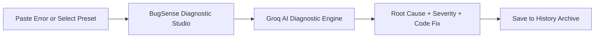

# ⚡ BugSense AI — Intelligent Code Debugging Suite

[](https://nextjs.org/)
[](https://react.dev/)
[](https://tailwindcss.com/)
[](https://groq.com/)
[](https://www.typescriptlang.org/)

**BugSense AI** is a next-generation developer workbench designed to decode cryptic stack traces, isolate root causes, and generate production-ready code fixes in seconds. Powered by high-speed Groq AI inference and styled entirely with pure Tailwind CSS v4.

---

## 🌟 Key Features

- **⚡ Real-Time AI Diagnostics:** High-speed, real-time code analysis powered by Groq's ultra-low-latency LPU engine.
- **🎯 Dual-Pane Diagnostic Workbench:** Dual-input studio for raw error logs and optional surrounding source code context across 13+ languages (JavaScript, TypeScript, Python, Go, Rust, Java, C++, and more).
- **🛡️ Root Cause & Severity Isolation:** Instant triage classifying errors into `low`, `medium`, `high`, or `critical` with deep architectural explanations.
- **📋 1-Click Production Code Patches:** Synthesizes verified, copy-pasteable code fixes with defensive checks and explanatory comments.
- **💾 Persistent Diagnostic Archive:** Save, search, filter, and review debugging history stored locally in your browser.
- **🎨 100% Pure Tailwind CSS v4:** Crafted with modern dark-mode developer aesthetics, glowing telemetry badges, and full responsive design for desktop, tablet, and mobile.

---

## 🚀 Quick Start Guide

### 1. Prerequisites
- **Node.js**: v18.18 or higher (v20+ recommended)
- **npm** or **yarn** / **pnpm**

### 2. Installation
Clone the repository and install the dependencies:

```bash
git clone https://github.com/your-username/bugsence.git
cd bugsence
npm install
```

### 3. Environment Setup
Create a `.env.local` file in the root directory (or use `.env.example` as a template):

```env
GROQ_API_KEY=your_groq_api_key_here
```

> **Note:** BugSense comes pre-configured with Groq API support so real AI diagnostics work immediately. Get your free API key at [console.groq.com](https://console.groq.com/keys).

### 4. Run the Development Server
```bash
npm run dev
```

Open [http://localhost:3000](http://localhost:3000) in your browser to launch BugSense.

---

## 💡 How to Use BugSense



1. **Dashboard (`/`):** View diagnostic statistics, supported language counts, and quick-start links.
2. **Select or Paste a Bug (`/analyzer`):**
   - Click any quick sample preset (`JS TypeError`, `Python KeyError`, `React Hook Error`, `Go Nil Pointer`) to autofill realistic error scenarios.
   - Or paste your own terminal output, stack trace, or compiler error with optional code context.
3. **Analyze:** Click **"Analyze Bug"** to initiate instant AI inspection.
4. **Inspect Resolution:** Review the structured breakdown:
   - **Error Summary & Severity:** Immediate triage badge.
   - **Root Cause & Technical Explanation:** Clear explanation of *why* the bug occurred.
   - **Corrected Code Solution:** One-click copy the verified patch.
5. **Save to History (`/history`):** Click **"Save to History"** to keep an audit trail of resolved issues that can be filtered and reviewed anytime.

---

## 🛠️ Tech Stack

| Layer | Technology | Purpose |
| :--- | :--- | :--- |
| **Framework** | Next.js 16 (App Router + Turbopack) | Modern server-side rendering & optimized routing |
| **UI Library** | React 19 | High-performance interactive components |
| **Styling** | Pure Tailwind CSS v4 | Responsive utility-first design without custom raw CSS |
| **Icons** | Lucide React | Clean, modern developer iconography |
| **AI Engine** | Groq LPU Inference API | Sub-second structured JSON code analysis |
| **Language** | TypeScript 5 | Strict end-to-end type safety |

---

## 📂 Project Structure

```text
bugsence/
├── app/
│   ├── analyzer/page.tsx    # Interactive Bug Analyzer Studio
│   ├── history/page.tsx     # Saved Diagnostic History & Search
│   ├── api/analyze/route.ts # Groq AI Diagnostic API Route
│   ├── layout.tsx           # Root Layout with Font & Meta config
│   ├── page.tsx             # Main Telemetry Dashboard
│   └── globals.css          # Tailwind CSS v4 entry point
├── components/
│   ├── features/
│   │   ├── analyzer/        # Form workbench, result cards, presets
│   │   └── history/         # History filters, cards, empty states
│   ├── layout/              # AppShell, Sidebar, TopNav
│   └── ui/                  # Pure Tailwind buttons, cards, badges
├── hooks/                   # Custom hooks (useAnalyze, useHistory)
├── lib/                     # Types, nav items, demo presets, utilities
├── public/                  # Static assets & icons
└── README.md
```

---

## 🧪 Build & Lint Verification

Verify that all type checks, linters, and static builds succeed with zero warnings or errors:

```bash
# Run ESLint
npm run lint

# Create production build
npm run build
```

---

## 📄 License
This project is open-source and available under the [MIT License](LICENSE).
