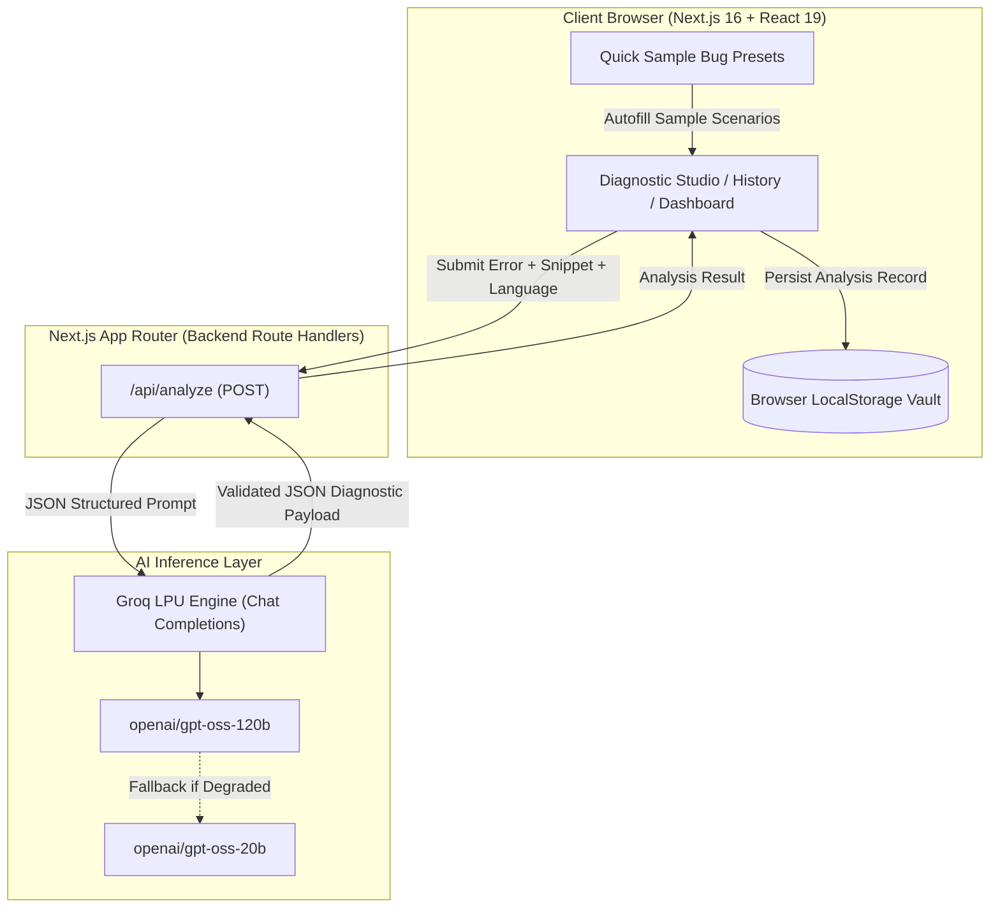

<div align="center">

# ⚡ BugSense AI

### Intelligent Automated Code Diagnostics & Patch Synthesis Suite

An enterprise-grade developer workbench designed to decode cryptic stack traces, isolate root causes, and generate production-ready code fixes in sub-second inference cycles.

[](https://nextjs.org/)
[](https://react.dev/)
[](https://www.typescriptlang.org/)
[](https://tailwindcss.com/)
[](https://groq.com/)
[](https://bugsence.vercel.app)
[](LICENSE)

<br />

[Explore Live Demo](https://bugsence.vercel.app) · [Report Bug](https://github.com/your-username/bugsence/issues) · [Request Feature](https://github.com/your-username/bugsence/issues)

</div>

---

## 📌 Table of Contents

- [Overview](#-overview)
- [Live Deployments](#-live-deployments)
- [Key Features](#-key-features)
- [System Architecture](#-system-architecture)
- [Tech Stack](#-tech-stack)
- [Project Structure](#-project-structure)
- [Getting Started](#-getting-started)
  - [Prerequisites](#1-prerequisites)
  - [Installation](#2-installation)
  - [Environment Configuration](#3-environment-configuration)
  - [Development Server](#4-run-development-server)
  - [Production Build](#5-production-build)
- [API Specification & Examples](#-api-specification--examples)
- [Supported Languages & Presets](#-supported-languages--presets)
- [Roadmap](#-roadmap)
- [Contributing](#-contributing)
- [License](#-license)

---

## 🔍 Overview

Debugging production exceptions, cryptic compiler outputs, and convoluted runtime stack traces often drains hours of engineering productivity. **BugSense AI** bridges the gap between raw machine errors and actionable code patches.

By pairing modern **Next.js 16 (Turbopack)** and **React 19** with **Groq's ultra-low-latency LPU inference**, BugSense provides near-instantaneous contextual debugging:
- Parses raw exceptions and optional surrounding code context.
- Classifies issue impact across standardized severity tiers (`low`, `medium`, `high`, `critical`).
- Isolates definitive architectural root causes.
- Synthesizes verified, defensive, drop-in code patches with inline explanations.
- Stores historical audit trails locally with instant search and filtering.

---

## 🌐 Live Deployments

| Resource | Target | Live URL | Status |
| :--- | :--- | :--- | :--- |
| **Production Application** | Primary Web App & Studio | [https://bugsence.vercel.app](https://bugsence.vercel.app) |  |

---

## 🌟 Key Features

### ⚡ Ultra-Low-Latency AI Diagnostics
Powered by Groq's high-throughput LPU inference cluster, reducing diagnostic turnaround from minutes of manual triage to sub-second automated analysis.

### 🎯 Dual-Pane Diagnostic Workbench
Structured dual-input studio supporting raw stack traces, terminal dumps, and optional surrounding source code context across 13+ modern programming languages.

### 🛡️ Automated Root Cause & Severity Triage
Provides immediate risk classification (`low` | `medium` | `high` | `critical`) alongside deep technical breakdowns explaining *why* the bug manifested.

### 📋 One-Click Production-Ready Code Patches
Synthesizes clean, defensible code fixes with defensive validation, safety checks, and clear inline comments ready to copy and paste.

### 💾 Local Diagnostic Archive & Audit Vault
Persists all past diagnostics in browser storage with instant text search, language filtering, chronological sorting, and full historical inspection.

### 🎨 Pure Tailwind CSS v4 Aesthetic
Crafted with modern developer dark aesthetics, telemetry glow badges, responsive grid layouts, and zero bloat.

---

## 🏗️ System Architecture



---

## 🛠️ Tech Stack

| Domain | Technology | Version | Purpose |
| :--- | :--- | :--- | :--- |
| **Framework** | [Next.js](https://nextjs.org/) | `16.4.5` | App Router, Turbopack, SSR, optimized edge routing |
| **UI Library** | [React](https://react.dev/) | `19.3.0` | React Server Components & client hooks |
| **Language** | [TypeScript](https://www.typescriptlang.org/) | `5.x` | Strict type validation across API contracts & UI state |
| **Styling** | [Tailwind CSS](https://tailwindcss.com/) | `v4.3.5` | High-performance, modern utility CSS styling |
| **AI Engine** | [Groq LPU](https://groq.com/) | API v1 | Ultra-fast LLM inference (`gpt-oss-120b` / `gpt-oss-20b`) |
| **Icons** | [Lucide React](https://lucide.dev/) | `1.70.0` | Consistent developer iconography |
| **Deployment** | [Vercel](https://vercel.com/) | Global Edge | Continuous deployment, CDN caching, edge routing |

---

## 📂 Project Structure

```text
bugsence/
├── app/
│   ├── analyzer/
│   │   └── page.tsx              # Diagnostic Studio page (form + results)
│   ├── api/
│   │   └── analyze/
│   │       └── route.ts          # Groq AI route handler with fallback models
│   ├── history/
│   │   └── page.tsx              # Diagnostic history vault and filter view
│   ├── favicon.ico               # Application favicon
│   ├── globals.css               # Tailwind CSS v4 styling entry point
│   ├── layout.tsx                # App root layout with theme & metadata
│   └── page.tsx                  # Telemetry dashboard & overview landing
├── components/
│   ├── features/
│   │   ├── analyzer/
│   │   │   ├── AnalysisResult.tsx # Structured result card, patch viewer & copy
│   │   │   └── AnalyzerForm.tsx   # Language selector, error input, code context
│   │   └── history/
│   │       ├── HistoryDetail.tsx  # Detailed historical inspection modal
│   │       └── HistoryList.tsx    # Filterable list of previous analyses
│   ├── layout/
│   │   ├── AppShell.tsx          # Top-level application container
│   │   ├── Sidebar.tsx           # Navigational sidebar with active states
│   │   └── TopNav.tsx            # Top header bar with quick links & metrics
│   └── ui/                       # Reusable UI primitives
│       ├── badge.tsx             # Severity & language badges
│       ├── button.tsx            # Action triggers & variant buttons
│       ├── card.tsx              # Container cards with border styling
│       ├── input.tsx             # Form text inputs
│       ├── separator.tsx         # Dividers & structural rules
│       └── textarea.tsx          # Multi-line code & log inputs
├── hooks/
│   ├── useAnalyze.ts             # Hook managing diagnostic state & API dispatch
│   └── useHistory.ts             # Hook managing localStorage archive persistence
├── lib/
│   ├── demo-data.ts              # Preset error samples across languages
│   ├── nav-items.tsx             # Route definitions & navigational metadata
│   ├── storage.ts                # Browser storage helper utilities
│   ├── types.ts                  # Shared TypeScript domain contracts
│   └── utils.ts                  # ClassName merging and formatting utilities
├── public/
│   ├── openapi.json              # OpenAPI 3.1 specification for BugSense
│   └── ...                       # Static SVGs and branding assets
├── .env.example                  # Environment configuration template
├── eslint.config.mjs             # ESLint 9 configuration
├── next.config.ts                # Next.js configuration
├── package.json                  # Dependencies and build scripts
├── postcss.config.mjs            # PostCSS configuration
├── tsconfig.json                 # TypeScript compiler configuration
└── README.md                     # Project documentation
```

---

## 🚀 Getting Started

Follow these steps to run BugSense locally on your development machine.

### 1. Prerequisites
- **Node.js**: `v18.18+` (v20+ LTS recommended)
- **Package Manager**: `npm`, `pnpm`, or `yarn`
- **Groq API Key**: A free key from [console.groq.com](https://console.groq.com/keys)

### 2. Installation
Clone the repository and install project dependencies:

```bash
git clone https://github.com/your-username/bugsence.git
cd bugsence
npm install
```

### 3. Environment Configuration
Create a `.env.local` file by copying the provided example:

```bash
cp .env.example .env.local
```

Open `.env.local` and add your Groq API key:

```env
# Groq API Key (Required)
GROQ_API_KEY=gsk_your_actual_groq_api_key_here
```

### 4. Run Development Server
Start the local Next.js development server with Turbopack:

```bash
npm run dev
```

Open your browser and navigate to:
- **Application Dashboard:** [http://localhost:3000](http://localhost:3000)
- **Bug Analyzer Studio:** [http://localhost:3000/analyzer](http://localhost:3000/analyzer)

### 5. Production Build
Verify types, linting, and compile the optimized production bundle:

```bash
# Run linting check
npm run lint

# Compile production build
npm run build

# Start production server
npm run start
```

---

## 📡 API Specification & Examples

### Endpoint: `POST /api/analyze`

Submits an error log and optional source code snippet to the BugSense AI diagnostic engine.

#### Request Headers
```http
Content-Type: application/json
```

#### Request Payload
```json
{
  "errorMessage": "TypeError: Cannot read properties of undefined (reading 'map')",
  "codeSnippet": "const renderList = (items) => {\n  return items.map(item => item.id);\n};",
  "language": "javascript"
}
```

#### Response Payload (`200 OK`)
```json
{
  "errorSummary": "Attempted to invoke .map() on an undefined or uninitialized array.",
  "possibleCause": "The 'items' parameter was passed as undefined or not supplied by the caller.",
  "explanation": "In JavaScript, calling array methods on non-array values causes a runtime TypeError. When an asynchronous query or missing prop provides undefined, the function halts execution.",
  "suggestedSolution": "1. Provide a default array parameter.\n2. Add optional chaining or array type verification before iterating.",
  "codeExample": "const renderList = (items = []) => {\n  // Guard against non-array or undefined inputs\n  if (!Array.isArray(items)) return [];\n  return items.map(item => item?.id);\n};",
  "severity": "high"
}
```

#### Error Response (`400 Bad Request`)
```json
{
  "error": "Please enter an error message or stack trace to diagnose."
}
```

---

## 🌐 Supported Languages & Presets

BugSense supports diagnostics across all primary runtime ecosystems:

| Language | Identifier | Sample Preset Included |
| :--- | :--- | :--- |
| **JavaScript** | `javascript` | `TypeError: Cannot read properties of undefined` |
| **TypeScript** | `typescript` | `TS2322: Type 'string' is not assignable to type 'number'` |
| **Python** | `python` | `KeyError: 'user_id' in dictionary access` |
| **Go** | `go` | `panic: runtime error: invalid memory address or nil pointer dereference` |
| **Rust** | `rust` | `cannot borrow '*self' as mutable more than once at a time` |
| **Java** | `java` | `java.lang.NullPointerException` |
| **C++** | `cpp` | `Segmentation fault (core dumped)` |
| **C#** | `csharp` | `System.NullReferenceException: Object reference not set` |
| **PHP** | `php` | `Fatal error: Uncaught Error: Call to undefined function` |
| **Ruby** | `ruby` | `NoMethodError: undefined method 'name' for nil:NilClass` |
| **Swift** | `swift` | `Fatal error: Unexpectedly found nil while unwrapping an Optional value` |
| **Kotlin** | `kotlin` | `KotlinNullPointerException` |
| **Other** | `other` | Custom stack traces & general compiler logs |

---

## 🗺️ Roadmap

- [x] Next.js 16 App Router & React 19 architecture
- [x] High-speed Groq LPU engine integration with automatic model fallback
- [x] Dual-pane analyzer studio with instant error presets
- [x] Local diagnostic history archive with filtering and keyword search
- [x] Tailwind CSS v4 design system
- [ ] Automated GitHub Action to run BugSense triage on repository issues
- [ ] Export diagnostic reports as Markdown and PDF summaries
- [ ] VS Code Extension for direct in-editor diagnosis

---

## 🤝 Contributing

Contributions make the open-source community an incredible place to learn, inspire, and create. Any contributions you make are **greatly appreciated**.

1. **Fork the Project**
2. **Create your Feature Branch** (`git checkout -b feature/AmazingFeature`)
3. **Commit your Changes** (`git commit -m 'Add some AmazingFeature'`)
4. **Push to the Branch** (`git push origin feature/AmazingFeature`)
5. **Open a Pull Request**

Please ensure that `npm run lint` and `npm run build` pass before submitting your PR.

---

## 📄 License

Distributed under the **MIT License**. See `LICENSE` for more information.

---

<div align="center">
  <sub>Built with ❤️ using Next.js 16, React 19, Tailwind CSS v4, and Groq LPU.</sub>
</div>
